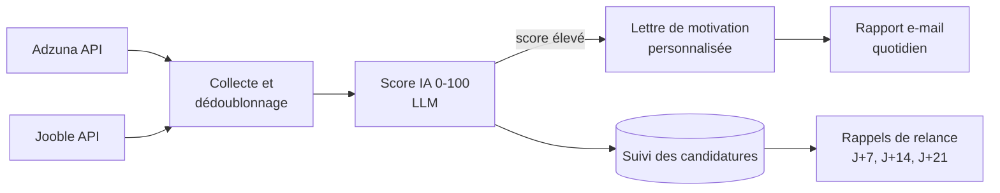

# Job Hunter AI

Un assistant qui automatise la partie répétitive de ma recherche d'emploi : chaque matin, il collecte les offres Data et IA en Suisse romande, les fait évaluer par un LLM au regard de mon profil, prépare une lettre de motivation pour les meilleures, et m'envoie un rapport par e-mail. Les décisions restent humaines : je relis et je postule moi-même.

> *EN : A personal job-search assistant. Every morning it collects Data/AI job offers in Western Switzerland, scores them against my profile with an LLM (free Groq tier), drafts tailored cover letters for the best matches and emails me a report. A human reviews and applies.*

## Pourquoi ce projet

Après neuf mois de recherche, je passais plus de temps à trier des offres qu'à préparer de bonnes candidatures. J'ai automatisé le tri pour me concentrer sur ce qui compte : les offres où mon profil colle vraiment.

## Fonctionnement



| Brique | Rôle | Fichier |
|---|---|---|
| Collecte | Interroge les API Adzuna et Jooble avec les mots-clés et la zone du profil, normalise et dédoublonne les offres. | `src/scrapers/` |
| Matching | Envoie l'offre et le profil au LLM, qui renvoie un score de 0 à 100, les points forts et les manques. | `src/matcher/ai_matcher.py` |
| Rédaction | Génère une lettre de motivation et un e-mail adaptés à chaque offre retenue. | `src/matcher/ai_matcher.py` |
| Suivi | Garde l'historique des offres vues, notées et envoyées, et calcule les relances à faire. | `src/tracker/tracker.py` |
| Rapport | Envoie un récapitulatif HTML avec les meilleures offres du jour. | `src/notifier/email_notifier.py` |
| Orchestration | Lance le cycle complet chaque matin via GitHub Actions. | `.github/workflows/daily_hunt.yml` |

## Choix de conception

- **Un humain valide chaque candidature.** L'outil ne contacte jamais un employeur : il prépare la lettre et le suivi, je relis et je postule moi-même.
- **Données personnelles hors du dépôt.** Les clés API sont des secrets GitHub, et l'historique des candidatures est conservé dans le cache privé de GitHub Actions, jamais publié ici.
- **Gratuit.** Le LLM tourne sur le niveau gratuit de Groq (modèle open source gpt-oss-120b), avec gestion automatique des limites de débit. Claude reste possible en option. GitHub Actions est gratuit pour un dépôt public.
- **Sources officielles uniquement.** Les offres viennent d'API publiques d'agrégateurs, sans scraping de sites qui l'interdisent.

## Commandes

```bash
python -m src.main hunt       # cycle complet : collecte, score, lettres, rapport
python -m src.main scan       # collecte et score uniquement
python -m src.main followup   # relances à faire
python -m src.main stats      # statistiques de la recherche
python -m src.main export     # export CSV du suivi
```

## Installation

```bash
git clone https://github.com/Toumil94/job-hunter-ai.git
cd job-hunter-ai
pip install -r requirements.txt
cp .env.example .env     # puis renseigner les clés
```

| Variable | Où l'obtenir |
|---|---|
| `GROQ_API_KEY` | console.groq.com/keys (gratuit, sans carte bancaire). Ou `ANTHROPIC_API_KEY` pour utiliser Claude. |
| `ADZUNA_APP_ID`, `ADZUNA_APP_KEY` | developer.adzuna.com (gratuit) |
| `JOOBLE_API_KEY` | jooble.org/api/about (gratuit) |
| `EMAIL_SENDER`, `EMAIL_APP_PASSWORD`, `EMAIL_RECIPIENT` | Un mot de passe d'application Gmail |

Le profil (compétences, mots-clés, zone de recherche) se règle dans `config/profile.yaml`, les seuils et le planning dans `config/settings.yaml`. Pour l'automatisation, ajouter les mêmes variables en secrets du dépôt (Settings, puis Secrets and variables, puis Actions).

## Stack

Python · LLM via Groq (gpt-oss-120b, gratuit) ou Claude · API Adzuna et Jooble · GitHub Actions · YAML

## Auteur

**Lyes Toumi**, Data & AI Engineer à Genève. [Portfolio](https://toumilyes.netlify.app) · [LinkedIn](https://www.linkedin.com/in/lyes-toumi/)
